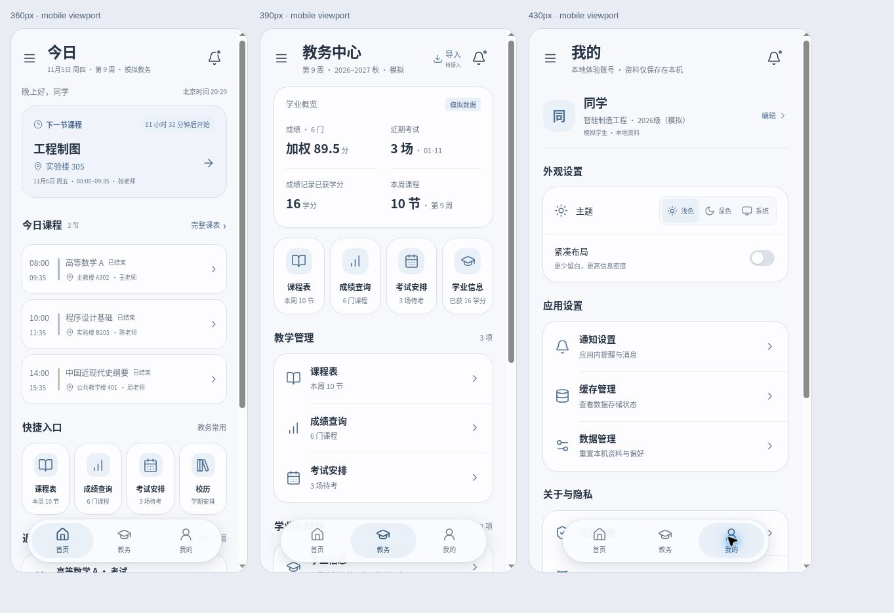

# 邯郸校园 · Handan Campus

面向邯郸学院学生的独立校园助手，Web 优先，未来提供 Android 与 iOS。当前 `v0.3.1` 支持个人真实课表管理与通用文件导入，非学校官方应用。

[手机预览（需要项目所有者登录）](https://handan-campus-start.dewydahlia.chatgpt.site) · [v0.2 设计系统](docs/DESIGN-SYSTEM.md) · [验证记录](docs/VALIDATION-v0.2.md)



## v0.4.1 接入验证（研究分支，未开放真实登录）

已核实学校公开页的正方平台及 V-9.0 标签，尚未确认第三方授权和本人课表 API。新增离线正方格式适配与回归测试，不注册学校连接器、不改动个人课表或正式导入入口。格式测试不等于邯郸学院真实账号验证。

[证据、拾光源码分析及阻塞条件](docs/V0.4.1-REAL-INTEGRATION.md) · [本轮测试记录](docs/VALIDATION-v0.4.1.md)

## v0.3.1 课表核心体验

教务主导航直接打开周课表。按节次和真实时间定位，跨节课程占据对应高度；重叠课程以可展开列表逐门查看。点击空白格直接添加，完整编辑使用独立页面；支持多个安排与按组设置教学周。

在“作息与设置 → 作息”配置每节课的时间，切换/另存前可预览联动课程的时间变化与冲突。旧v0.3安排迁移为独立时间，保留原值；新建课程默认按节次随作息联动。payload版本2同时支持恢复v1备份。

[源码对比与技术取舍](docs/RESEARCH-v0.3.1.md) · [本轮验证与操作说明](docs/VALIDATION-v0.3.1.md)

## v0.3 实用课表

- 多学期配置、课程多时间安排、手动增删改、单双周与冲突校验。
- CSV / XLSX / ICS 本机解析、字段映射、预览、合并/替换；版本化 JSON 备份恢复。
- 首页与日/周课表实时联动，Web IndexedDB / 原生 Preferences 持久化，生产 Web 资源离线缓存。
- 原生本地课程提醒已接入；Web 明确提示后台提醒不可用。

[使用说明与导入限制](docs/V0.3-GUIDE.md) · [实际测试结果](docs/VALIDATION-v0.3.md)

## v0.2.1 补充改造

首页下一节课改为可整卡点击的紧凑三行布局，今日课程合并为单个分隔列表。悬浮胶囊置于内容滚动区之外的专用底部空间，避免仅依靠页面尾部 padding 导致的中途遮挡。课程数据与状态算法保持不变。

[本轮验证与未执行项目](docs/VALIDATION-v0.2.1.md) · [本地场景测试说明](tests/manual/README.md)

## 已实现

- 首页：实时计算今日课程状态、跨日下一节课、教学周、快捷入口与近期安排。
- 教务：概览与分组服务、1–18 周课表、紧凑日/周视图、周跳转、课程详情、单双周过滤；成绩学期筛选和搜索、学分加权平均；考试、模拟学业进度、模拟校历、官方外链。
- 个人：昵称/专业编辑、浅色/深色/系统主题、紧凑布局、演示应用内提醒、重置本机偏好、隐私说明。
- 独立内容滚动区/悬浮胶囊底栏、安全区、焦点圈、弹窗焦点约束与 Escape 关闭、减少动效支持。

**演示模式所有数据均为虚构。个人模式仅课程与学期来自用户创建/导入，成绩、考试、学业进度仍是独立演示。** 首页按北京时间计算课程状态与下一次课程；演示学期从 2026-09-07 开始，共18周，个人学期由用户设置，均不代表学校官方数据。

## 运行

Node.js 22 LTS 或以上，使用仓库中的 package-lock.json。

```sh
npm ci
npm run dev
npm test
npm run build
```

Vue 3 + TypeScript + Vite；无远端教务 API，无账号注册，无追踪 SDK，无第三方字体请求。默认浅色，以本地 localStorage 保存非敏感偏好。课表存储不可用时不覆盖原数据，显示错误和重试入口。个人课表与演示数据独立。

## 原生平台

Android/iOS 工程已生成，`capacitor.config.ts` 使用 `dist/`；本期未构建签名安装包。

```sh
npm run cap:sync
npx cap open android
npx cap open ios
```

Android 需要 Android Studio/SDK/JDK；iOS 构建与签名需要 macOS/Xcode，发布需相应开发者账号。修改应用标识、签名与版本后再发布。Android/iOS 不申请相机、定位权限；课程提醒仅在用户主动开启时申请通知权限。原生构建及真机提醒待验证；iOS 还需 macOS 上执行 pod install。

## 结构

- `src/domain/academic.ts`：类型、课表筛选、时间与成绩计算。
- `src/services/academic.ts`：AcademicProvider 契约与独立模拟数据源。
- `src/services/preferences.ts`：带字段校验的本机偏好与故障降级。
- `src/App.vue`：三个模块与应用状态编排。
- `src/components/`：统一页头、悬浮导航、概览、课程卡和分组列表等组件。
- `src/composables/navigation.ts`：模块、子页面与浮层的返回历史。
- `src/domain/presentation.ts`：北京时间、课程状态和跨日课程查找。
- `src/tokens.css`：颜色、排版、间距、动效、暗色和安全区域设计变量。
- `src/style.css`：响应式布局、设计变量、动效和主题。
- `android/`、`ios/`：Capacitor 壳。
- `tests/`：计算和存储边界测试。
- `docs/RESEARCH.md`：四个参考仓库的架构、UI、许可证研究。
- `docs/VALIDATION-v0.2.md`：本次已执行检查与验证范围。
- `docs/DESIGN-SYSTEM.md`：v0.2 设计系统与交互规则。
- `.github/workflows/ci.yml`：push/PR 自动测试及生产构建。

## 后续接入

先取得学校系统访问与数据使用授权，再实现新的 AcademicProvider。不要在前端硬编码凭据或尝试绕过验证码、认证、网络限制。真实会话管理、数据规范化、接口错误与隐私策略需要随接入方案一起设计；当前没有用假后端冒充真实服务。

## 贡献

参见 [CONTRIBUTING.md](CONTRIBUTING.md)。原创代码 MIT；设计研究来源与上游许可记录见 [docs/RESEARCH.md](docs/RESEARCH.md)。本期不包含交易、社区、商家或失物招领。

## 学校授权连接框架（尚未接入学校）

主线保留学校授权连接的接口、状态机、只读数据视图与严格校验，默认没有注册真实连接器。“教务 → 教务服务 → 官方教务”明确显示未接入；不能据此声称可以登录邯郸学院或自动同步课表。原本个人课表和导入仍独立可用。

[接入边界与后续条件](docs/V0.4-ACADEMIC-CONNECTION.md) · [PR #1 审查与验证](docs/PR-1-REVIEW.md)
